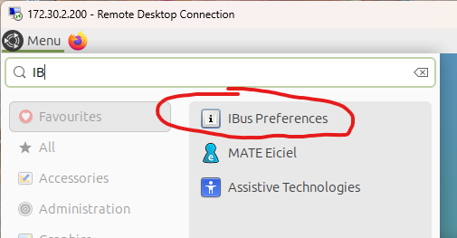

# Ubuntu Chinese Locale & Input

> [!summary] Summary
> Ubuntu 24.04: make the **whole system Chinese**, or only **type Chinese**. Pick one first; the steps differ.

> [!important] Choose first
> | You want | Do |
> |---|---|
> | Full Chinese system + input | Sections 1 to 3 |
> | English UI, Chinese typing only | Section 4 (don't touch `LANG`, `LANGUAGE`, `LC_ALL`) |
> | Remote desktop (xrdp + MATE) | Section 5 |

---

## 1. Chinese Locale

```bash
sudo apt-get update
sudo apt-get install language-pack-zh-hans

sudo dpkg-reconfigure locales
```

In the menu, select `zh_CN.UTF-8` to generate it, and choose it again as the **default locale**.

Then add to the end of `~/.profile` (`vim ~/.profile`; install Vim first with `sudo apt install vim` if missing):

```bash
export LANG=zh_CN.UTF-8
export LANGUAGE=zh_CN:zh
export LC_ALL=zh_CN.UTF-8
```

Apply and check:

```bash
source ~/.profile
echo $LANG $LANGUAGE $LC_ALL      # zh_CN.UTF-8 zh_CN:zh zh_CN.UTF-8
sudo reboot                        # so the desktop and all apps load the new locale
```

> [!warning] These three lines switch your whole user environment to Chinese
> If you only want to **type** Chinese and keep an English UI, skip this section and use section 4.

---

## 2. Built-in Intelligent Pinyin

After rebooting: **Settings → Keyboard → Input Sources → Add Input Source → Chinese → Intelligent Pinyin**. Switch input methods with the indicator in the top bar.

## 3. Can't find Intelligent Pinyin?

Configure the input-method framework through Ubuntu's **Language Support** settings.

---

## 4. Chinese Typing Only (English UI)

Ubuntu 24.04 + GNOME + Wayland: set up an input-method framework on its own, and **don't** change `LANG` / `LANGUAGE` / `LC_ALL`:

```text
Fcitx5  +  fcitx5-chinese-addons  +  Pinyin
```

---

## 5. Remote Desktop: xrdp + MATE

Use the three `export` lines from section 1, then choose **IBus Preferences**: search `IB` in the MATE menu.

> [!example]- Screenshot
> 

See also [[Ubuntu xrdp MATE Remote Desktop]].

---

## Source

Section 1 to 3 are adapted from this CSDN article: https://blog.csdn.net/unravel_tom/article/details/139360244
