# Ubuntu KVM Virtual Machines

> [!summary] Contents
> 1. Install KVM
> 2. Bridge network (VM on the real LAN)
> 3. Create a virtual Ubuntu
> 4. Share a folder with VirtioFS
> 5. Extra: images on another disk, ISO won't boot
> 6. Ubuntu 26.04 differences

> [!tip] Written on 24.04, same steps on 26.04
> The screenshots are from 24.04. Section 6 lists what is different on 26.04.

---

## 1. Install KVM

**1. Check CPU virtualization support (Intel VT-x / AMD-V)**

```bash
egrep -c '(vmx|svm)' /proc/cpuinfo
lscpu | grep Virtualization
```

> [!warning] Result `0`?
> Enable **Intel VT-x** or **AMD-V / SVM Mode** in the BIOS.

**2. Update**

```bash
sudo apt update
sudo apt upgrade -y
```

**3. Install the KVM environment**

```bash
sudo apt install -y qemu-kvm libvirt-daemon-system libvirt-clients bridge-utils virt-manager
```

**4. Enable and check the service**

```bash
sudo systemctl enable --now libvirtd
sudo systemctl status libvirtd        # expect: active (running)
```

**5. Add your user to the groups**

```bash
sudo usermod -aG libvirt $USER
sudo usermod -aG kvm $USER
newgrp libvirt                         # or log out and back in, more reliable
```

**6. Verify**

```bash
virsh list --all
kvm-ok                                 # expect: KVM acceleration can be used
```

> [!example]- Screenshot: the normal result
> 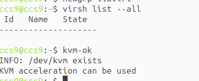

**7. Start the GUI tool**

```bash
virt-manager
```

---

## 2. Bridge Network

A bridge puts the VM **directly on the physical LAN** (instead of libvirt's default NAT).

**1. Find your real interface name first, don't assume `enp1s0`:**

```bash
ip -br link
```

**2. Edit** `/etc/netplan/01-network-manager-all.yaml`:

```yaml
network:
  version: 2
  renderer: networkd

  ethernets:
    enp1s0:                    # your real interface
      dhcp4: no

  bridges:
    br0:
      interfaces:
        - enp1s0
      dhcp4: no
      addresses:
        - 172.30.2.201/24      # the host's IP lives on br0
      routes:
        - to: default
          via: 172.30.2.1
      nameservers:
        addresses:
          - 8.8.8.8
          - 8.8.4.4
```

**3. Validate, apply, check:**

```bash
sudo netplan generate        # no output = no errors
sudo netplan apply
ip addr show br0             # the host IP should be on br0
ip route
```

> [!warning] Remote SSH / RDP will disconnect if the config is wrong
> Keep local console access, or use `sudo netplan try`. Reboot if the bridge still misbehaves.

For a **static IP on both the host and the VM**, set the VM's network like this:

> [!example]- Screenshot
> 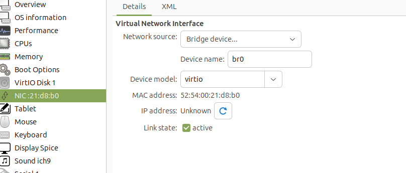

---

## 3. Create a Virtual Ubuntu

**1. Move the ISO into libvirt's image folder**

```bash
sudo mv ~/ubuntu-24.04.3-desktop-amd64.iso /var/lib/libvirt/images/
cd /var/lib/libvirt; sudo chmod -R 755 images
```

**2. Create the machine**: `virt-manager` → *Create a new virtual machine* → *Local install media (ISO)* → pick the ISO → set CPU, RAM, disk → choose `br0` as the network if the VM needs the real LAN → start the install.

> [!example]- Screenshots
> Create a new machine
> 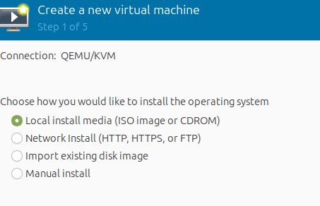
> Select the Ubuntu ISO
> 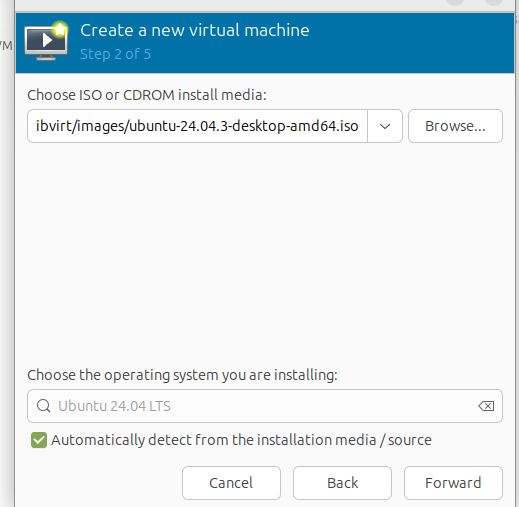

**3. After installing and rebooting you may hit a display problem**

> [!warning] Make sure 3D acceleration is **not** selected
> `VM → View Details → Video / Display`.

> [!example]- Screenshots
> The problem
> 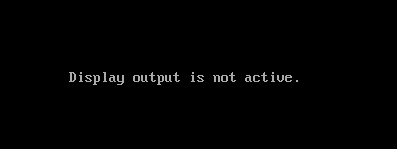
> The setting
> 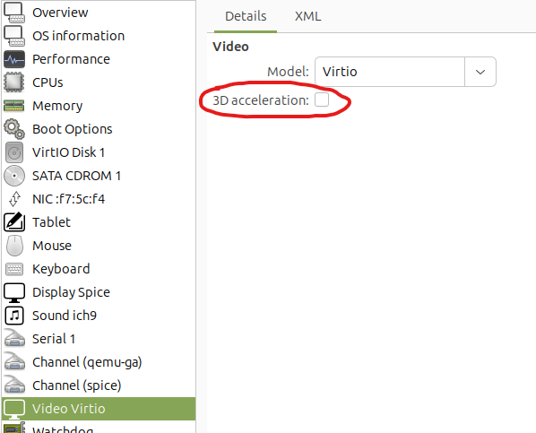

---

## 4. Share a Folder with VirtioFS

**1. Create the host folder**

```bash
mkdir -p ~/vmshare
```

**2. Enable shared memory in the VM**

> [!example]- Screenshot
> 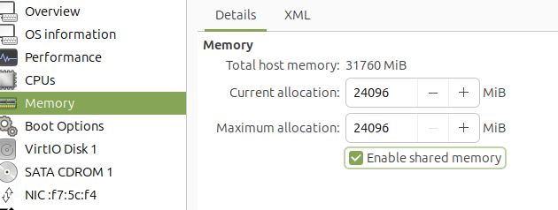

**3. Add the filesystem**: `VM → View Details → Add Hardware → Filesystem`, driver `virtiofs`, source `/home/<user>/vmshare`, target `vmshare`.

> [!example]- Screenshot
> 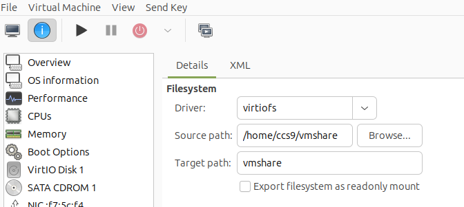

**4. If the VM fails to start with an error**

> [!example]- Screenshot of the error
> 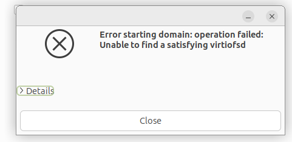

Fix on the **host**:

```bash
sudo apt update
sudo apt install virtiofsd qemu-system-common
sudo systemctl restart libvirtd

ls /usr/lib/qemu/virtiofsd        # must exist, always test this
```

**5. Mount inside the VM**

```bash
sudo mkdir /mnt/vmshare
sudo mount -t virtiofs vmshare /mnt/vmshare
```

---

## 5. Extra

### Keep VM images on another disk

Create the folder, move the ISO into it, then give libvirt's QEMU user access:

```bash
sudo mkdir -p /media/neu/kvm_images

sudo setfacl -m u:libvirt-qemu:rx /media/neu
sudo setfacl -R -m u:libvirt-qemu:rwx /media/neu/kvm_images
getfacl /media/neu/kvm_images        # check
```

The first `setfacl` gives `x` on the parent `/media/neu`, otherwise QEMU can't reach the folder below it. See [[Ubuntu Users, Permissions & Delete Protection]].

### ISO isn't booted: change the boot order

`VM → View Details → Boot Options`: enable the CDROM / ISO and put it **before** the virtual disk.

> [!example]- Screenshots
> 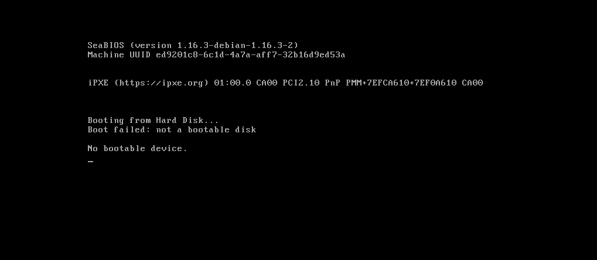
> 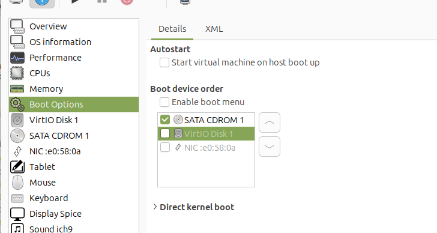

---

## 6. Ubuntu 26.04 Differences

> [!note] Ubuntu 26.04 LTS (Resolute Raccoon)
> - Same workflow; the repositories already ship a newer libvirt / QEMU stack, so install nothing by hand.
> - Use `ubuntu-26.04-desktop-amd64.iso` instead of the 24.04 ISO.
> - `virtiofsd` comes from the official repositories.
> - Netplan still supports bridges with `networkd` or `NetworkManager`.

**Quick check of the whole setup:**

```bash
lsb_release -a
uname -r
kvm-ok
systemctl status libvirtd
virsh list --all
virsh net-list --all
ip -br addr
ip addr show br0                      # if using a bridge
ls -l /usr/lib/qemu/virtiofsd         # if using VirtioFS
```
