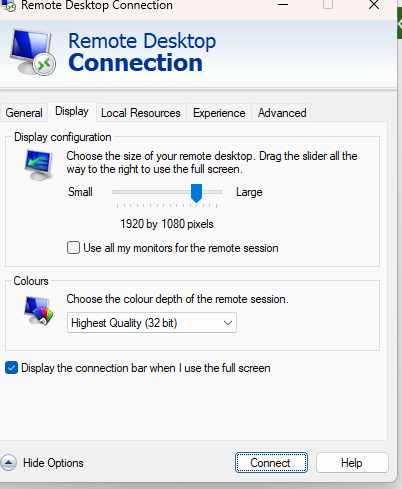
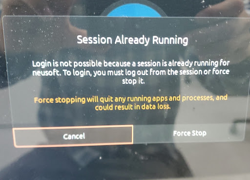

# Ubuntu xrdp + MATE Remote Desktop

> [!summary] Summary
> Use Ubuntu from Windows (`mstsc`) with **no monitor attached**: switch to **Xorg + MATE**, install **xrdp**, and know the two usual fixes (restart the services; "session already running").

---

## 1. Why Xorg + MATE

Without a monitor, **Xorg + MATE** is the recommended combination.

| Layer | Ubuntu default | After switching |
|---|---|---|
| **Desktop environment** | GNOME | MATE |
| **Display protocol** | Wayland (or Xorg) | Xorg |

---

## 2. Install & Configure

```bash
sudo apt update
sudo apt install mate-core mate-desktop-environment mate-desktop-environment-extras -y
sudo apt install xrdp -y
```

**1. `/etc/xrdp/startwm.sh`** (`sudo vi /etc/xrdp/startwm.sh`) with this content:

```sh
#!/bin/sh
if [ -r /etc/default/locale ]; then
  . /etc/default/locale
  export LANG LANGUAGE
fi
export XDG_SESSION_TYPE=x11
exec mate-session
```

**2. `/etc/gdm3/custom.conf`**: turn Wayland off, in the `[daemon]` section:

```ini
WaylandEnable=false
```

**3. Start MATE for your user, then restart xrdp:**

```bash
echo "mate-session" > ~/.xsession
chmod +x ~/.xsession
sudo systemctl restart xrdp
```

**4. Firefox access:**

```bash
echo "export XAUTHORITY=$HOME/.Xauthority" >> ~/.Xauthority
```

> [!warning] Check this last line
> `~/.Xauthority` is a **binary cookie file**, so appending a text line to it can corrupt it. The `export` line probably belongs in `~/.xsession` (or `~/.profile`). If Firefox works for you as written, leave it; if X logins start to fail, remove that line.

---

## 3. Remote Session Misbehaves

Restart the services:

```bash
sudo systemctl restart xrdp
sudo systemctl restart gdm3
```

---

## 4. `mstsc` Display Settings

In Remote Desktop Connection → **Display** tab, the defaults are:

- **Display configuration:** `1920 by 1080` pixels
- **Colours:** **Highest Quality (32 bit)** for the best speed and look. On a poor network, **lower** this value.

> [!example]- Screenshot
> 

---

## 5. "Session Already Running"

> [!bug] Symptom
> **`Login is not possible because a session is already running for <user>.`**
> The dialog offers **Cancel** and **Force Stop**, but **Force Stop can't be clicked**.

> [!warning] Force stopping quits all running apps and may lose data

> [!example]- Screenshot
> 

**Fix: kill the old session from a text console**

1. Switch to a TTY: `Ctrl + Alt + F3` (or `F4` / `F5` / `F6`)
2. Log in with your user name and password
3. Kill all of that user's leftover processes:

```bash
sudo killall -u <user>
```

4. Go back to the graphical screen: `Ctrl + Alt + F1` (or `F2` / `F7`, depends on the system)

If it happens often, check for abnormal logouts and leftover Xorg / Wayland processes with `ps -u <user>`.
