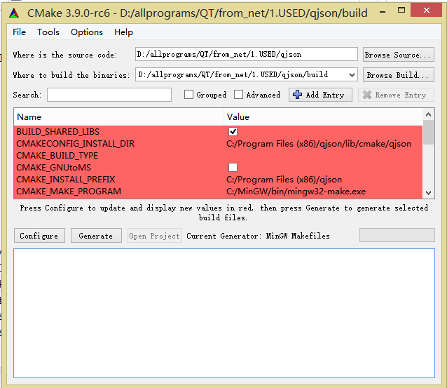
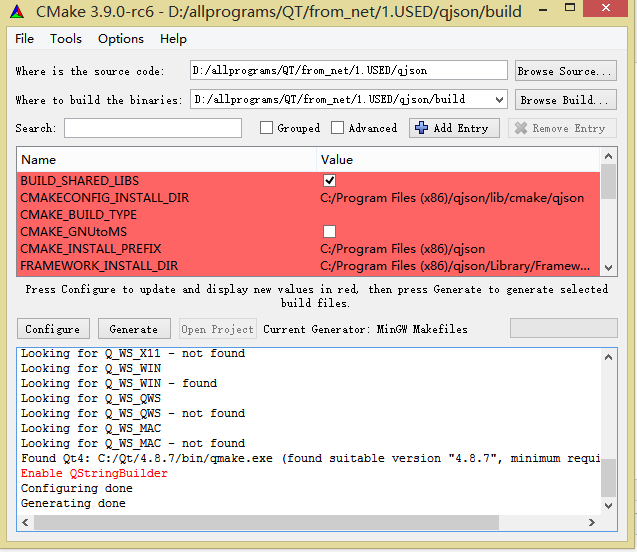
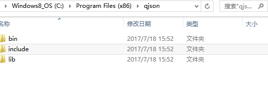

# Building QJson on Windows

> [!summary] Summary
> Build and install the **QJson** library on Windows with **CMake + MinGW**, then use it from a Qt project.

> [!warning] Only needed for Qt 4
> QJson is a Qt 4 era library. **Qt 5 and later have `QJsonDocument` built in.** The build log in this note found **Qt 4.8.7**.

**What you need [versions used]:**

- QJson source: https://github.com/flavio/qjson (version 0.9.0)
- CMake: https://cmake.org/download/ (used `cmake-3.9.0-rc6-win64-x64.msi`), installed in `C:\Program Files\CMake\bin` and **added to the `PATH`** environment variable
- MinGW (`gcc.exe` and `g++.exe` already in `PATH`)

---

## Steps

**1. Go into the QJson folder, create a build folder, and run CMake**

```bat
cd qjson
mkdir build
cd build
cmake ..
```

> [!tip] If a Visual Studio toolchain is installed and there is no error
> Just open `ALL_BUILD.vcxproj` and build it. You are done.

**2. If `cmake ..` fails** with `CMAKE_C_COMPILER` / `CMAKE_CXX_COMPILER` not specified, the C and C++ compilers are not set. Use **`cmake-gui.exe`** (in `C:\Program Files\CMake\bin`) instead:

1. Set **Where is the source code** (the qjson folder) and **Where to build the binaries** (its `build` folder)
2. **Add Entry**, type `STRING`: `CMAKE_C_COMPILER` = `gcc`, and `CMAKE_CXX_COMPILER` = `g++`
3. Click **Configure** and pick the generator **MinGW Makefiles**. This is the same as running `cmake -G "MinGW Makefiles" ..`
4. Click **Generate**: the makefiles appear in the `build` folder

> [!example]- Screenshots
> The cmake-gui settings, and the result after Configure + Generate (it found Qt 4.8.7)
> 
> 

**3. Build and install, in a command prompt run as Administrator**

```bat
cd build
mingw32-make
mingw32-make install
```

The files are installed to `CMAKE_INSTALL_PREFIX` (shown in cmake-gui). You get three folders, `bin`, `include` and `lib`.

> [!example]- Screenshot: the result
> 

---

## Use it in a Qt project

The DLL in `bin` is what you need. Copy the three folders (`bin`, `include`, `lib`) into your project folder, and add to the `.pro` file:

```qmake
INCLUDEPATH += ../include
LIBS += -L.. -llib/qjson
```

Adjust the paths to your own layout. In this example the project folder was `Qjsontest`, holding the three folders, and the DLL was moved into `lib`. If it compiles without errors, it works.
