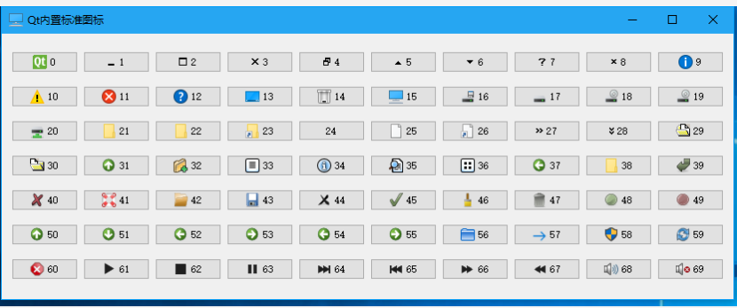
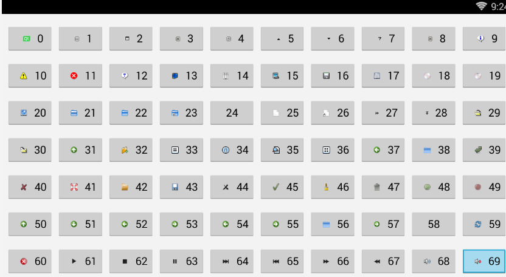
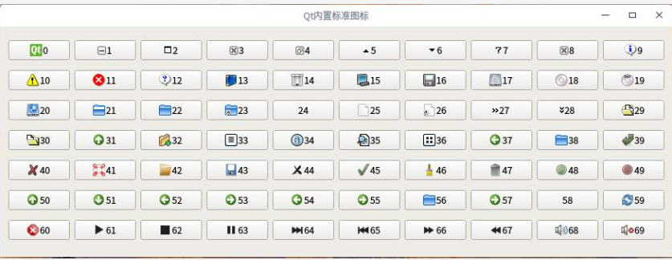
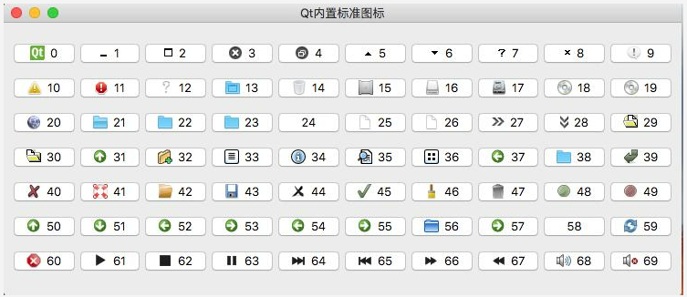

# Qt Basics

> [!summary] Contents
> 1. Downloads
> 2. Classes worth remembering
> 3. Basics and small rules
> 4. Built-in icons (`QStyle`)
>
> More tips and pitfalls: [[Qt Tips & Pitfalls]]

---

## 1. Downloads

- Current and archived releases: https://download.qt.io/
- Old archive (Qt 4 and early Qt 5): https://download.qt.io/new_archive/qt/

---

## 2. Classes Worth Remembering

| Class | Note |
|---|---|
| `QTextEdit` | Does not refresh in real time |
| `QTextCodec` | Text encoding conversion (Qt 4 / 5; moved to the Core5Compat module in Qt 6) |
| `QByteArray` | Like a `vector` of chars: small in memory, good for embedded work, converts to and from `QString` |
| `QVariantHash` | Based on `QHash`: **unordered** |
| `QVariantMap` | Based on `QMap`: **ordered** |
| `QIcon` | Can use the built-in icons directly (see section 4) |
| `QFileDialog` | Open / save file dialogs |
| `QJson` | Third-party JSON library (`qjson.lib`, `qjson.dll`), only needed for Qt 4: see [[Building QJson on Windows]] |
| `QPainter` | Qt drawing: lets you draw any custom widget |
| `QMetaType` | `qRegisterMetaType` registers your own types for use in signals and slots |
| `QStackedWidget` | Switch between multiple pages |
| `QDir` | Folder and file management |
| `QSettings` | Settings storage (INI file or registry) |

Also used: `QLabel`, `QPushButton`, `QButtonGroup`, `QVBoxLayout`, `QGridLayout`, `QTreeWidget`, `QTreeWidgetItem`, `QPlainTextEdit`, `QStringList`, `QCoreApplication`, `QApplication`, `QWSServer` (Qt 4 embedded).

### Mouse events

```cpp
QEvent::MouseButtonPress
QEvent::MouseButtonRelease
QEvent::MouseButtonDblClick
QEvent::MouseMove
QEvent::Wheel
```

---

## 3. Basics and Small Rules

- **Window basics:** set a picture, a shape and a transparent background; `setModal` makes a dialog modal.
- **Deleting widgets:** Qt deletes children together with their parent. If you delete by hand, delete the child widgets **before** the parent.
- **`QVBoxLayout` always draws a border line?** Put the layout inside a `QFrame`, set the frame's border to 0, and don't let it overlap neighbouring widgets.
- **`inherits()` checks the class hierarchy:**

```cpp
QTimer *timer = new QTimer;          // QTimer inherits QObject
timer->inherits("QTimer");           // true
timer->inherits("QObject");          // true
```

- **Dynamic ("weak") properties:** `widget->dynamicPropertyNames()` lists their names, `widget->property("name")` reads one.
- **Sleeping without freezing the program, three ways:** `boost` sleep, `QCoreApplication`, `QTime`.
- **Tools:**
  - Find `uic.exe` in Qt Creator's `bin` folder: it turns a `.ui` file into `.h` / `.cpp` code.
  - Style the whole UI by loading a `.qss` file.

---

## 4. Built-in Icons (`QStyle`)

Qt ships about 70 standard icons inside `QStyle`; use them directly:

```cpp
QPushButton btn("TEST");
QStyle *style = QApplication::style();
QIcon icon = style->standardIcon(QStyle::SP_DriveCDIcon);
btn.setIcon(icon);
```

Examples: `SP_TitleBarMenuButton`, `SP_TitleBarMinButton`, `SP_TitleBarMaxButton`, `SP_TitleBarCloseButton`, `SP_MessageBoxInformation`, `SP_MessageBoxWarning`, `SP_MessageBoxCritical`, `SP_MessageBoxQuestion`, `SP_DriveCDIcon`, ... The full list is the `QStyle::StandardPixmap` enum in the Qt documentation.

The number next to each icon below is its enum value. The icons look different on each system:

> [!example]- Windows 10
> 

> [!example]- Android
> 

> [!example]- Linux
> 

> [!example]- Mac
> 
