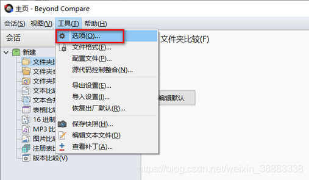
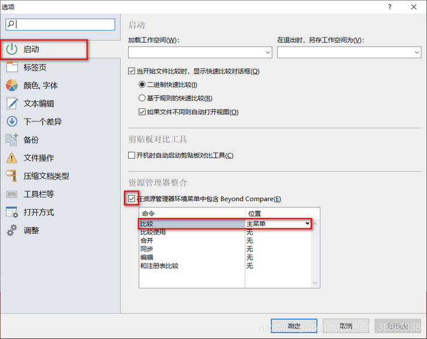

# Beyond Compare [文件对比工具]

> [!summary] Summary [概要]
> Install on Ubuntu, compare from the terminal, and add it to the Windows right-click menu.
> [在 Ubuntu 安装、从终端对比文件、添加到 Windows 右键菜单。]

> [!note] License [授权]
> Trial over? Buy a license at scootersoftware.com. The old trial-reset and key steps were removed from this note.
> [试用到期请到官网购买授权。旧的试用重置和密钥步骤已从本笔记移除。]

---

## 1. Install on Ubuntu [Ubuntu 安装]

**A. Package downloaded from the official site [已从官网下载安装包]**

```bash
sudo dpkg -i bcompare-<version>_amd64.deb
```

**B. Not downloaded yet: wget + gdebi (resolves dependencies) [还没下载：wget + gdebi，自动解决依赖]**

```bash
wget http://www.scootersoftware.com/bcompare-4.2.8.23479_amd64.deb
sudo apt-get update
sudo apt-get install gdebi-core
sudo gdebi bcompare-4.2.8.23479_amd64.deb
```

> [!warning] 4.2.8 is an old version [4.2.8 是旧版本]
> Check the website for the latest `.deb` and use that file name. [到官网下载最新 `.deb` 并替换文件名。]

**Uninstall [卸载]**

```bash
sudo apt-get remove bcompare
```

## 2. Use from the terminal [终端使用]

```bash
bcompare 1.txt 2.txt        # compare two files [对比两个文件]

# Optional short command `bcp` [可选：建立短命令 bcp]
sudo ln -s /usr/bin/bcompare /usr/bin/bcp
```

## 3. Add to the Windows right-click menu [添加到 Windows 右键菜单]

1. Open Beyond Compare → **Tools → Options** [工具 → 选项]
2. Left side: **Startup**; on the right tick **Include Beyond Compare in Explorer context menu**, and set the **Compare** command's dropdown to **Main menu**
   [左侧选"启动"，右侧勾选"在资源管理器环境菜单中包含 Beyond Compare"，并把"比较"命令的下拉选为主菜单]
3. Click **OK** [点击确定]

> [!example]- Screenshots [截图]
> 
> 
