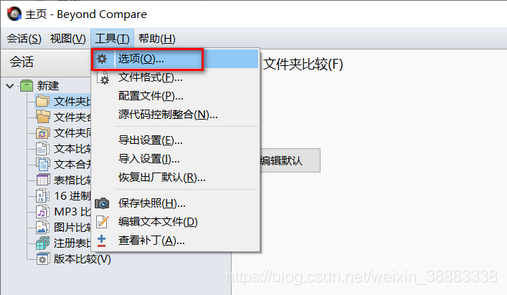
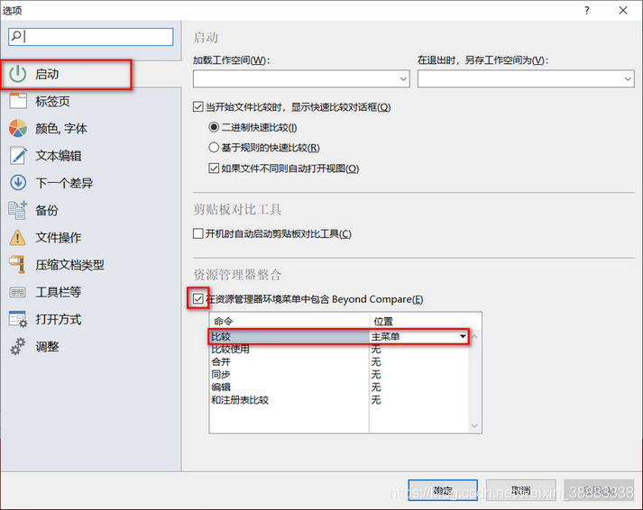

# Beyond Compare

> [!summary] Summary
> Install on Ubuntu, compare from the terminal, and add it to the Windows right-click menu.

> [!note] License
> Trial over? Buy a license at scootersoftware.com. The old trial-reset and key steps were removed from this note.

---

## 1. Install on Ubuntu

**A. Package downloaded from the official site**

```bash
sudo dpkg -i bcompare-<version>_amd64.deb
```

**B. Not downloaded yet: wget + gdebi (resolves dependencies)**

```bash
wget http://www.scootersoftware.com/bcompare-4.2.8.23479_amd64.deb
sudo apt-get update
sudo apt-get install gdebi-core
sudo gdebi bcompare-4.2.8.23479_amd64.deb
```

> [!warning] 4.2.8 is an old version
> Check the website for the latest `.deb` and use that file name.

**Uninstall**

```bash
sudo apt-get remove bcompare
```

## 2. Use from the terminal

```bash
bcompare 1.txt 2.txt        # compare two files

# Optional short command `bcp`
sudo ln -s /usr/bin/bcompare /usr/bin/bcp
```

## 3. Add to the Windows right-click menu

1. Open Beyond Compare → **Tools → Options**
2. Left side: **Startup**; on the right tick **Include Beyond Compare in Explorer context menu**, and set the **Compare** command's dropdown to **Main menu**
3. Click **OK**

> [!example]- Screenshots
> 
> 
