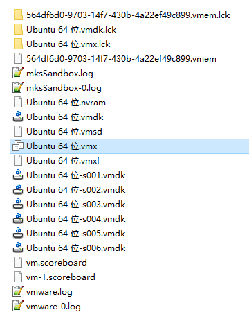
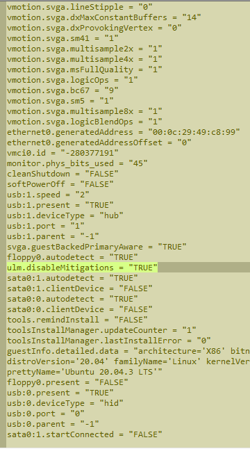

# VMware Fixes [VMware 常见问题]

> [!summary] Summary [概要]
> 1. VM "in use" and can't take ownership [虚拟机正在使用，获取所有权失败]
> 2. Turn off side-channel mitigations [关闭侧通道缓解]
> 3. Host can't ping the VM after sleep [虚拟机休眠后 ping 不通]

---

## 1. VM "In Use" / Taking Ownership Fails [虚拟机正在使用，获取所有权失败]

> [!bug] Symptom [现象]
> Opening the VM says it is in use. Clicking **Take Ownership** fails with "Cannot open the virtual machine". Usually caused by an abnormal VM shutdown.
> [打开虚拟机提示正在使用；点击"获取所有权"弹出"无法打开虚拟机"。一般是 VM 异常关闭造成的。]

**Fix [解决]:** go to the VM's storage folder and delete the `*.lck` files / folders.
[进入虚拟机存放目录，删除后缀为 `.lck` 的文件（夹）。]

> [!caution] Make sure the VM is really closed first [先确认虚拟机已经真正关闭]

---

## 2. Turn Off Side-Channel Mitigations (VMware Player) [关闭侧通道缓解]

1. Find the VM config file `*.vmx` in the VM's install folder [在虚拟机目录找到 `*.vmx`]
2. Open it in a text editor and add this line [用文本编辑器打开，添加]:

```text
ulm.disableMitigations = "TRUE"
```

> [!example]- Screenshots [截图]
> Locate the `.vmx` file [找到 `.vmx`]
> 
> After adding the line [添加之后]
> 

> [!note] Trade-off [取舍]
> Mitigations slow the VM down; turning them off is faster but gives up that protection. Fine for a trusted local VM.
> [缓解措施会拖慢虚拟机；关闭后更快，但失去相应保护。可信的本地虚拟机可以关闭。]

---

## 3. Host Can't Ping the VM After Sleep [虚拟机休眠后 ping 不通]

> [!bug] Symptom [现象]
> After the VM sleeps and the network drops, the VM could ping the host before, but now it can't.
> [虚拟机休眠断网以后，之前可以 ping 通主机 IP，之后不能 ping 通。]

**Fix [解决]:** disable **all** network adapters, then reconnect them. [把所有网卡全部禁用，然后重新连接一遍。]
