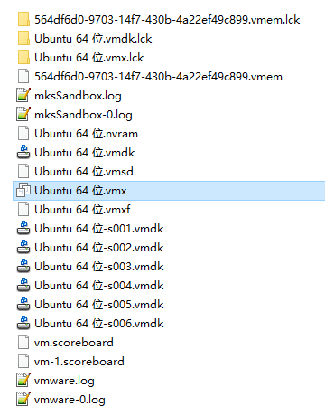
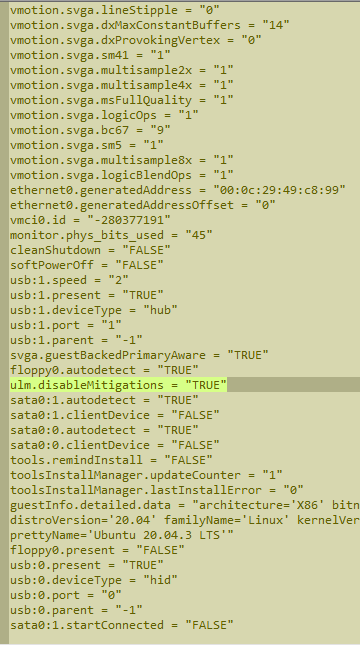

# VMware Fixes

> [!summary] Summary
> 1. VM "in use" and can't take ownership
> 2. Turn off side-channel mitigations
> 3. Host can't ping the VM after sleep

---

## 1. VM "In Use" / Taking Ownership Fails

> [!bug] Symptom
> Opening the VM says it is in use. Clicking **Take Ownership** fails with "Cannot open the virtual machine". Usually caused by an abnormal VM shutdown.

**Fix:** go to the VM's storage folder and delete the `*.lck` files / folders.

> [!caution] Make sure the VM is really closed first

---

## 2. Turn Off Side-Channel Mitigations (VMware Player)

1. Find the VM config file `*.vmx` in the VM's install folder
2. Open it in a text editor and add this line:

```text
ulm.disableMitigations = "TRUE"
```

> [!example]- Screenshots
> Locate the `.vmx` file
> 
> After adding the line
> 

> [!note] Trade-off
> Mitigations slow the VM down; turning them off is faster but gives up that protection. Fine for a trusted local VM.

---

## 3. Host Can't Ping the VM After Sleep

> [!bug] Symptom
> After the VM sleeps and the network drops, the VM could ping the host before, but now it can't.

**Fix:** disable **all** network adapters, then reconnect them.
