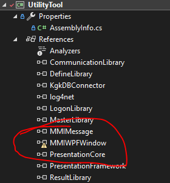
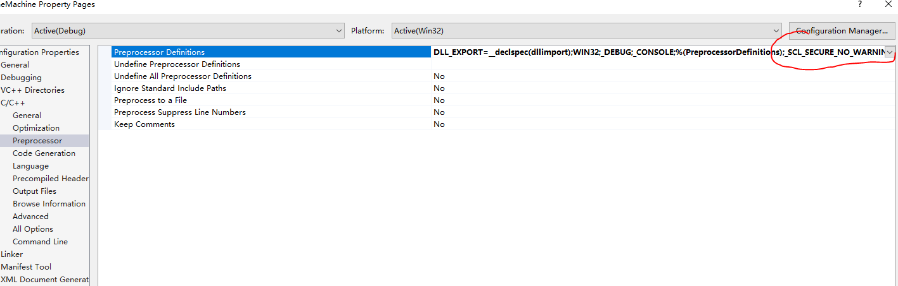
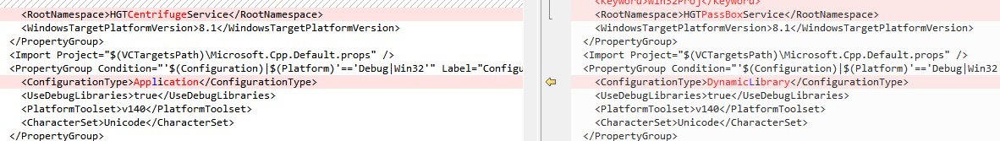

# Visual Studio Build Errors [VS 编译与链接错误]

> [!summary] Summary [概要]
> Fixes for Visual Studio C++ projects, in the order you hit them: **1 Setup → 2 Link errors → 3 Runtime → 4 Packaging**.
> [Visual Studio C++ 工程问题，按遇到的顺序排列：**1 环境 → 2 链接错误 → 3 运行错误 → 4 打包**。]

> [!tip] The `DLL_EXPORT` macro shows up three times below [`DLL_EXPORT` 宏会反复出现]
> Usual rule: the **lib** project uses `dllexport`, the project that **imports** the lib uses `dllimport`. Most lib-related errors in 2.4 / 3.x come from getting this wrong.
> [通常规则：**lib 工程**用 `dllexport`，**引用 lib 的工程**用 `dllimport`。2.4 / 3.x 中大部分 lib 相关错误都是这里搞反了。]

---

## 1. Setup & Opening a Project [环境与打开工程]

### 1.1 Missing WPFToolkit / yellow "!" [找不到 WPFToolkit / 黄色感叹号]

> [!warning] Build step 1: clear every yellow exclamation mark first [编译第一步：先解决所有黄色感叹号]

Project can't find WPFToolkit → install `WPFToolkit.msi`. [工程找不到 WPFToolkit → 安装 `WPFToolkit.msi`。]

> [!example]- Screenshot [截图]
> 

### 1.2 Fresh VS install can't find C++ libraries / headers [刚装好的 VS 找不到 C++ 库和头文件]

No need to uninstall: run the installer again → **Repair** → tick the C++ components → download online.
[不用卸载：重新运行安装包 → **修复** → 勾选 C++ 相关库 → 在线下载安装。]

### 1.3 Solution opens as x64, want x86 by default [解决方案默认打开 x64，想默认 x86]

Open the `.sln` file in a text editor and delete every `x64` entry. [用文本编辑器打开 `.sln`，删除所有 `x64` 相关项。]

> [!caution] Back up the `.sln` first [先备份 `.sln`]

### 1.4 Garbled text / UTF-8 errors when importing a project [导入工程出现乱码 / UTF-8 报错]

Install `vc_mbcsmfc.exe` (MFC MBCS library). [安装 `vc_mbcsmfc.exe`（MFC 多字节字符集库）。]

### 1.5 Red squiggles on `#include`, but the build passes [编译通过，头文件仍有红色波浪线]

Right-click the project → **Rescan Solution**. [工程右键 → **重新扫描解决方案**。]

---

## 2. Link Errors [链接错误]

### 2.1 LNK2019: unresolved external symbol `_WinMain@16`

```text
LNK2019: unresolved external symbol _WinMain@16 referenced in function "int __cdecl invoke_main(void)"
```

**Fix [解决]:** Project Properties → **Linker → System → SubSystem**: change `Windows` to `Console`.

### 2.2 Protobuf: unresolved external symbol [无法解析的外部符号]

```text
unresolved external symbol "class google::protobuf::internal::ExplicitlyConstructed<class std::basic_string<char,...>>"
```

**Fix, either one [任选其一]:**

1. Add `#define PROTOBUF_USE_DLLS` in the generated header [在生成的头文件中添加]
2. **C/C++ → Preprocessor → Preprocessor Definitions**: add `PROTOBUF_USE_DLLS` [在预处理器定义中添加]

### 2.3 `min` / `max` macro conflict [`min` / `max` 宏冲突]

```text
warning C4003: not enough actual parameters for macro 'min'
error   C2589: '(': illegal token on right side of '::'
```

Cause: the Windows header macros `min` / `max` (`minwindef.h`) clash with `limits`. [原因：Windows 头文件里的 `min` / `max` 宏与 `limits` 冲突。]

```cpp
// Option 1 (may NOT work) [可能不生效]: before the header includes
#define NOMINMAX

// Option 2 (recommended) [推荐]: after the includes
#undef min
#undef max
```

### 2.4 LNK2001 / LNK1120 when importing a lib [导入 lib 时的 LNK2001 / LNK1120]

```text
error LNK2001: unresolved external symbol "public: static struct QMetaObject const QssFontFactory::staticMetaObject"
fatal error LNK1120: 1 unresolved externals
```

Likely caused by the `.vcxproj`. [可能由 `.vcxproj` 引起。]

**Fix [解决]:** open the `.vcxproj`, find `DLL_EXPORT` inside `PreprocessorDefinitions`, and change

```text
DLL_EXPORT=__declspec(dllexport)   →   DLL_EXPORT=__declspec(dllimport)
```

### 2.5 C4996: `std::copy` unsafe parameters

```text
Error C4996 'std::copy::_Unchecked_iterators::_Deprecate': Call to 'std::copy' with parameters that may be unsafe...
To disable this warning, use -D_SCL_SECURE_NO_WARNINGS.
```

**Fix [解决]:** add `_SCL_SECURE_NO_WARNINGS` to **Preprocessor Definitions**.

> [!example]- Screenshot [截图]
> 

---

## 3. Runtime Errors [运行错误]

### 3.1 Access violation after importing a lib [导入 lib 后运行崩溃]

```text
Exception thrown at 0x00043B80 in HGTCentrifugeManage.exe: 0xC0000005:
Access violation executing location 0x00043B80.
```

**Fix [解决]:** when building the **lib** project, set `ConfigurationType` to `DynamicLibrary` in its `.vcxproj`.
[编译 lib 工程时，在 `.vcxproj` 中把 `ConfigurationType` 改成 `DynamicLibrary`。]

> [!example]- Screenshot [截图]
> 

### 3.2 Can't find the exe that matches the lib at runtime [运行时找不到 lib 对应的 exe]

In `PreprocessorDefinitions`, change `_WINDOWS` to `_CONSOLE`: [把 `_WINDOWS` 改成 `_CONSOLE`：]

```xml
<!-- before [修改前] -->
<PreprocessorDefinitions>WIN32;_DEBUG;_WINDOWS;%(PreprocessorDefinitions);DLL_EXPORT=__declspec(dllexport);</PreprocessorDefinitions>

<!-- after [修改后] -->
<PreprocessorDefinitions>WIN32;_DEBUG;_CONSOLE;%(PreprocessorDefinitions);DLL_EXPORT=__declspec(dllexport);</PreprocessorDefinitions>
```

---

## 4. Packaging [打包]

### Build an exe with an icon [编译带图标的 exe]

1. Make an `.ico` file (any online icon maker) [制作 `.ico` 图片，用在线工具即可]
2. Right-click the project → **Add → Resource → Icon → Import**, pick the `.ico` [工程右键 → 添加 → 资源 → Icon → 导入]
3. Rebuild: the new exe now has the icon [重新编译，新的 exe 已带图标]

> [!warning] If something goes wrong [如果出现异常]
> Delete the `.rc`, `.ico` and `resource.h` files from the project, then redo the steps. [把 `.rc`、`.ico`、`resource.h` 全部删除后重做。]
