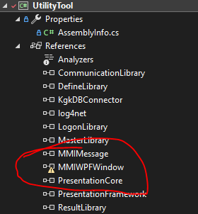
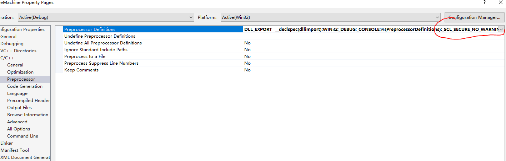
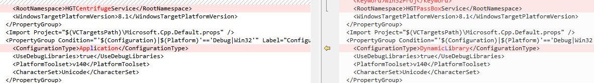

# Visual Studio Build Errors

> [!summary] Summary
> Fixes for Visual Studio C++ projects, in the order you hit them: **1 Setup → 2 Link errors → 3 Runtime → 4 Packaging**.

> [!tip] The `DLL_EXPORT` macro shows up three times below
> Usual rule: the **lib** project uses `dllexport`, the project that **imports** the lib uses `dllimport`. Most lib-related errors in 2.4 / 3.x come from getting this wrong.

---

## 1. Setup & Opening a Project

### 1.1 Missing WPFToolkit / yellow "!"

> [!warning] Build step 1: clear every yellow exclamation mark first

Project can't find WPFToolkit → install `WPFToolkit.msi`.

> [!example]- Screenshot
> 

### 1.2 Fresh VS install can't find C++ libraries / headers

No need to uninstall: run the installer again → **Repair** → tick the C++ components → download online.

### 1.3 Solution opens as x64, want x86 by default

Open the `.sln` file in a text editor and delete every `x64` entry.

> [!caution] Back up the `.sln` first

### 1.4 Garbled text / UTF-8 errors when importing a project

Install `vc_mbcsmfc.exe` (MFC MBCS library).

### 1.5 Red squiggles on `#include`, but the build passes

Right-click the project → **Rescan Solution**.

---

## 2. Link Errors

### 2.1 LNK2019: unresolved external symbol `_WinMain@16`

```text
LNK2019: unresolved external symbol _WinMain@16 referenced in function "int __cdecl invoke_main(void)"
```

**Fix:** Project Properties → **Linker → System → SubSystem**: change `Windows` to `Console`.

### 2.2 Protobuf: unresolved external symbol

```text
unresolved external symbol "class google::protobuf::internal::ExplicitlyConstructed<class std::basic_string<char,...>>"
```

**Fix, either one:**

1. Add `#define PROTOBUF_USE_DLLS` in the generated header
2. **C/C++ → Preprocessor → Preprocessor Definitions**: add `PROTOBUF_USE_DLLS`

### 2.3 `min` / `max` macro conflict

```text
warning C4003: not enough actual parameters for macro 'min'
error   C2589: '(': illegal token on right side of '::'
```

Cause: the Windows header macros `min` / `max` (`minwindef.h`) clash with `limits`.

```cpp
// Option 1 (may NOT work): before the header includes
#define NOMINMAX

// Option 2 (recommended): after the includes
#undef min
#undef max
```

### 2.4 LNK2001 / LNK1120 when importing a lib

```text
error LNK2001: unresolved external symbol "public: static struct QMetaObject const QssFontFactory::staticMetaObject"
fatal error LNK1120: 1 unresolved externals
```

Likely caused by the `.vcxproj`.

**Fix:** open the `.vcxproj`, find `DLL_EXPORT` inside `PreprocessorDefinitions`, and change

```text
DLL_EXPORT=__declspec(dllexport)   →   DLL_EXPORT=__declspec(dllimport)
```

### 2.5 C4996: `std::copy` unsafe parameters

```text
Error C4996 'std::copy::_Unchecked_iterators::_Deprecate': Call to 'std::copy' with parameters that may be unsafe...
To disable this warning, use -D_SCL_SECURE_NO_WARNINGS.
```

**Fix:** add `_SCL_SECURE_NO_WARNINGS` to **Preprocessor Definitions**.

> [!example]- Screenshot
> 

---

## 3. Runtime Errors

### 3.1 Access violation after importing a lib

```text
Exception thrown at 0x00043B80 in HGTCentrifugeManage.exe: 0xC0000005:
Access violation executing location 0x00043B80.
```

**Fix:** when building the **lib** project, set `ConfigurationType` to `DynamicLibrary` in its `.vcxproj`.

> [!example]- Screenshot
> 

### 3.2 Can't find the exe that matches the lib at runtime

In `PreprocessorDefinitions`, change `_WINDOWS` to `_CONSOLE`:

```xml
<!-- before -->
<PreprocessorDefinitions>WIN32;_DEBUG;_WINDOWS;%(PreprocessorDefinitions);DLL_EXPORT=__declspec(dllexport);</PreprocessorDefinitions>

<!-- after -->
<PreprocessorDefinitions>WIN32;_DEBUG;_CONSOLE;%(PreprocessorDefinitions);DLL_EXPORT=__declspec(dllexport);</PreprocessorDefinitions>
```

---

## 4. Packaging

### Build an exe with an icon

1. Make an `.ico` file (any online icon maker)
2. Right-click the project → **Add → Resource → Icon → Import**, pick the `.ico`
3. Rebuild: the new exe now has the icon

> [!warning] If something goes wrong
> Delete the `.rc`, `.ico` and `resource.h` files from the project, then redo the steps.
