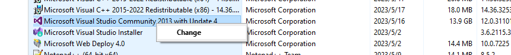
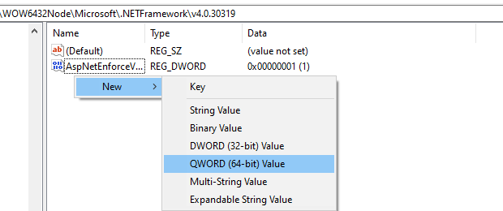
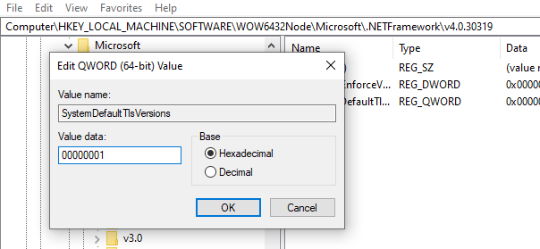
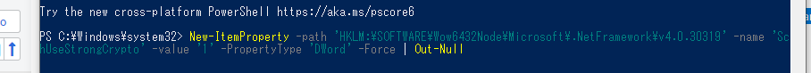

# Visual Studio Setup & Debug [VS 安装、登录与调试]

> [!summary] Summary [概要]
> 1. Sign-in / license problems [登录与许可证问题]
> 2. Debug process hangs and can't be killed [调试进程卡死]

---

## 1. Sign-in / License Problems [登录与许可证问题]

> [!bug] Symptoms [现象]
> - `the online service is not available`
> - `sign in, sorry, we ran into a problem`
> - Can't enter the license [license 无法输入]

Try the steps in order. [按顺序尝试。]

### Step 1 — Clear the old account info [清除旧账号登录信息]

1. Go to the VS 2013 install folder [进入 VS 2013 安装目录]:
   `C:\Program Files\Microsoft Visual Studio\2013\Professional\Common7\IDE`
2. Open **cmd as Administrator** in that folder (or **Developer Command Prompt for VS2013** as Administrator) [以管理员身份打开 cmd]
3. Run [执行]:

```bat
devenv /resetuserdata
```

> [!tip]- Still not working? Clean the registry [还不行？清理注册表]
> Back up the key first. Under the key below, delete everything and keep only `(Default)`:
> [先备份。删除下面这个键下的所有内容，只保留 `(Default)`：]
> ```text
> HKEY_CURRENT_USER\Software\Microsoft\VSCommon\12.0\ClientServices\TokenStorage\VisualStudio\IdeUser
> ```

### Step 2 — Repair [修复]

1. Control Panel → right-click Visual Studio → **Change → Repair** [控制面板 → 右键 VS → 更改 → 修复]
2. When it finishes, close it, wait a few minutes, then restart [完成后关闭，等待几分钟再重新启动]

> [!example]- Screenshot [截图]
> 

### Step 3 — Enable strong crypto (TLS 1.2), then sign in again [启用强加密，重新登录]

Add two DWORD values (= `1`) so the old .NET Framework uses strong crypto, which the sign-in server needs.
[添加两个 DWORD 值（= `1`），让旧版 .NET Framework 使用强加密，登录服务器需要它。]

```text
HKEY_LOCAL_MACHINE\SOFTWARE\WOW6432Node\Microsoft\.NETFramework\v4.0.30319
    SystemDefaultTlsVersions = 00000001
    SchUseStrongCrypto       = 00000001
```

Or in **PowerShell (Administrator)** [或用管理员 PowerShell]:

```powershell
New-ItemProperty -Path 'HKLM:\SOFTWARE\Wow6432Node\Microsoft\.NetFramework\v4.0.30319' -Name 'SystemDefaultTlsVersions' -Value '1' -PropertyType 'DWord' -Force | Out-Null
New-ItemProperty -Path 'HKLM:\SOFTWARE\Wow6432Node\Microsoft\.NetFramework\v4.0.30319' -Name 'SchUseStrongCrypto'       -Value '1' -PropertyType 'DWord' -Force | Out-Null
```

> [!example]- Screenshots [截图]
> Registry [注册表]
> 
> 
> 
>
> PowerShell
> 
> 

---

## 2. Debug Process Hangs [调试进程卡死]

> [!bug] Symptoms [现象]
> - The process hangs while debugging, and is still hung after stopping [调试中进程卡死，停止运行后依旧卡死]
> - The project's process can't be found in Task Manager [任务管理器里也找不到工程的进程]

**Fix: kill it from cmd [用 cmd 强制关闭]**

```bat
:: 1. Find the process by keyword (HGT = the process name prefix)
tasklist | findstr "HGT*"

:: 2. Kill every PID that shows up (repeat for each one)
taskkill /PID <PID> /F /T
```

> [!example]- Screenshots [截图]
> 
> 

> [!tip] Still stuck? Check the USB port [还是不行？检查 USB 口]
> The USB port / external device may be locked: **unplug and replug the USB device**.
> [USB 口可能被锁定：**重新插拔 USB 外设**。]
