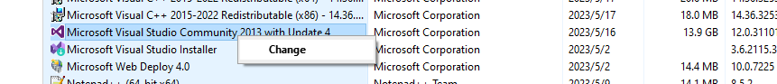
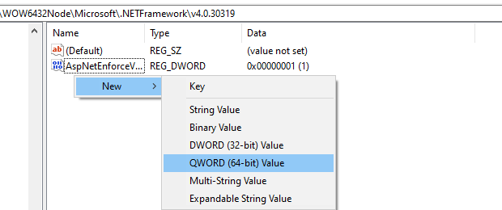
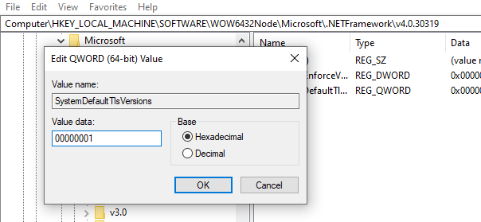
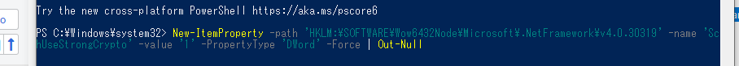

# Visual Studio Setup & Debug

> [!summary] Summary
> 1. Sign-in / license problems
> 2. Debug process hangs and can't be killed

---

## 1. Sign-in / License Problems

> [!bug] Symptoms
> - `the online service is not available`
> - `sign in, sorry, we ran into a problem`
> - Can't enter the license

Try the steps in order.

### Step 1 — Clear the old account info

1. Go to the VS 2013 install folder:
   `C:\Program Files\Microsoft Visual Studio\2013\Professional\Common7\IDE`
2. Open **cmd as Administrator** in that folder (or **Developer Command Prompt for VS2013** as Administrator)
3. Run:

```bat
devenv /resetuserdata
```

> [!tip]- Still not working? Clean the registry
> Back up the key first. Under the key below, delete everything and keep only `(Default)`:
> ```text
> HKEY_CURRENT_USER\Software\Microsoft\VSCommon\12.0\ClientServices\TokenStorage\VisualStudio\IdeUser
> ```

### Step 2 — Repair

1. Control Panel → right-click Visual Studio → **Change → Repair**
2. When it finishes, close it, wait a few minutes, then restart

> [!example]- Screenshot
> 

### Step 3 — Enable strong crypto (TLS 1.2), then sign in again

Add two DWORD values (= `1`) so the old .NET Framework uses strong crypto, which the sign-in server needs.

```text
HKEY_LOCAL_MACHINE\SOFTWARE\WOW6432Node\Microsoft\.NETFramework\v4.0.30319
    SystemDefaultTlsVersions = 00000001
    SchUseStrongCrypto       = 00000001
```

Or in **PowerShell (Administrator)**:

```powershell
New-ItemProperty -Path 'HKLM:\SOFTWARE\Wow6432Node\Microsoft\.NetFramework\v4.0.30319' -Name 'SystemDefaultTlsVersions' -Value '1' -PropertyType 'DWord' -Force | Out-Null
New-ItemProperty -Path 'HKLM:\SOFTWARE\Wow6432Node\Microsoft\.NetFramework\v4.0.30319' -Name 'SchUseStrongCrypto'       -Value '1' -PropertyType 'DWord' -Force | Out-Null
```

> [!example]- Screenshots
> Registry
> 
> 
> 
>
> PowerShell
> 
> 

---

## 2. Debug Process Hangs

> [!bug] Symptoms
> - The process hangs while debugging, and is still hung after stopping
> - The project's process can't be found in Task Manager

**Fix: kill it from cmd**

```bat
:: 1. Find the process by keyword (HGT = the process name prefix)
tasklist | findstr "HGT*"

:: 2. Kill every PID that shows up (repeat for each one)
taskkill /PID <PID> /F /T
```

> [!example]- Screenshots
> 
> 

> [!tip] Still stuck? Check the USB port
> The USB port / external device may be locked: **unplug and replug the USB device**.
