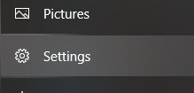
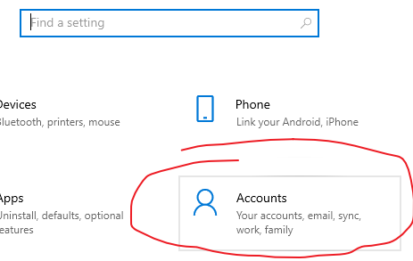
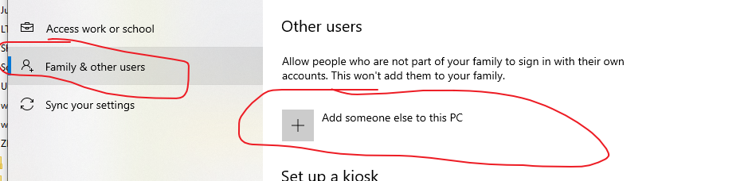
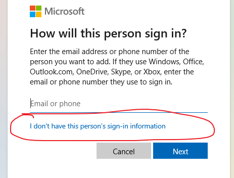
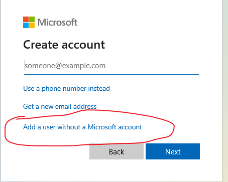
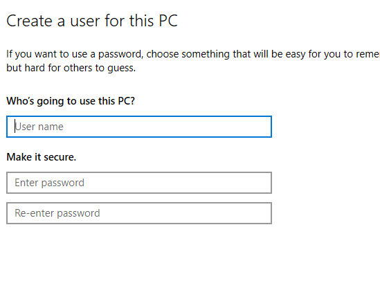
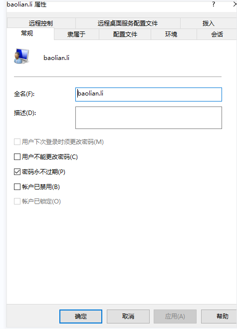

# Windows Accounts & Permissions [账户与权限]

> [!summary] Contents [目录]
> 1. Create a local user [创建本地用户]
> 2. Give a domain account admin rights [给域账户添加管理员权限]
> 3. Shared folder password expired [共享目录密码过期]
> 4. Enable Remote Desktop [开启远程桌面]

> [!tip] Two key tools [两个关键工具]（`Win + R`）
> - `lusrmgr.msc`: Local Users and Groups [本地用户和组] (Pro / Enterprise only [仅专业版 / 企业版])
> - `netplwiz`: User Accounts, can add domain accounts [用户账户，可添加域账户]

---

## 1. Create a Local User [创建本地用户]

**Settings → Accounts → Family & other users → Add someone else to this PC**
[**设置 → 账户 → 家庭和其他用户 → 将其他人添加到这台电脑**]

Then choose: *I don't have this person's sign-in information* → *Add a user without a Microsoft account* → enter name & password.
[然后选择：*我没有这个人的登录信息* → *添加一个没有 Microsoft 账户的用户* → 输入用户名和密码。]

> [!example]- Screenshots [截图]（Win10）
> 1. Settings → Accounts [设置 → 账户]
> 
> 
> 2. Family & other users → Add someone else to this PC [家庭和其他用户 → 添加其他人]
> 
> 3. No sign-in information [没有登录信息]
> 
> 4. Without Microsoft account [不使用 Microsoft 账户]
> 
> 5. Enter name & password [输入用户名和密码]
> 

---

## 2. Give a Domain Account Admin Rights [给域账户添加管理员权限]

1. Run `C:\Windows\System32\Netplwiz.exe` [运行 `Netplwiz.exe`]
2. **Add** → enter the domain account (e.g. `DOMAIN\username`) [**添加** → 输入域账号]
3. Set the group to **Administrators** [组选择 **管理员**]

---

## 3. Shared Folder Password Expired [共享目录密码过期]

> [!warning] Symptom → cause [症状 → 原因]
> Shared folder suddenly asks for a password / access denied → the **share account's password expired** (Windows expires passwords by default).
> [共享目录突然要求密码或拒绝访问 → **共享账户的密码过期了**（Windows 默认密码会过期）。]

1. `Win + R` → `lusrmgr.msc` [打开本地用户和组]
2. **Users** → right-click the share account → **Properties** [**用户** → 右键共享账户 → **属性**]
3. ☐ Uncheck **User must change password at next logon** [取消勾选 **用户下次登录时须更改密码**]
4. ☑ Check **Password never expires** [勾选 **密码永不过期**]

---

## 4. Enable Remote Desktop [开启远程桌面]

1. **This PC → Properties → Remote settings** → enable **Allow remote connections to this computer**
   [**此电脑 → 属性 → 远程设置** → 开启 **允许远程连接到此计算机**]
2. `lusrmgr.msc` → set a user and password for remote login [设置远程登录用的用户和密码]
3. Connect with that user via `mstsc` [用该用户通过 `mstsc` 远程登录]

> [!note] The account must have a password [账户必须设置密码]
> Remote Desktop refuses accounts with an empty password. [空密码账户无法远程登录。]
