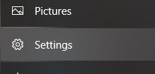
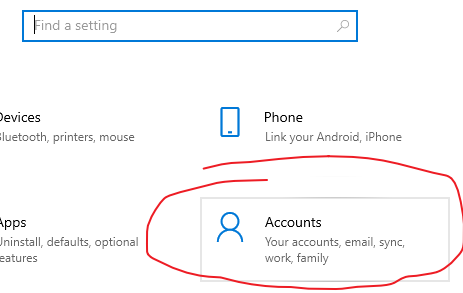
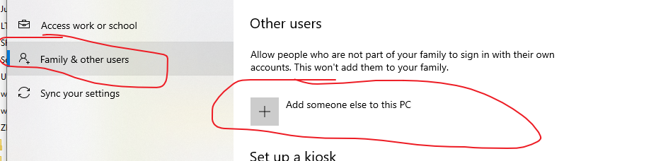
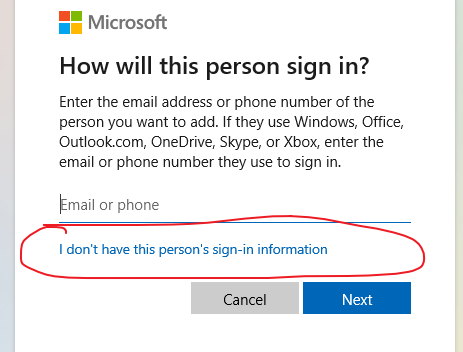
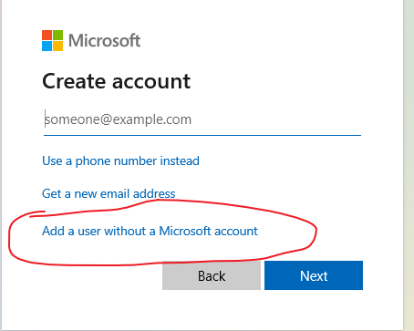
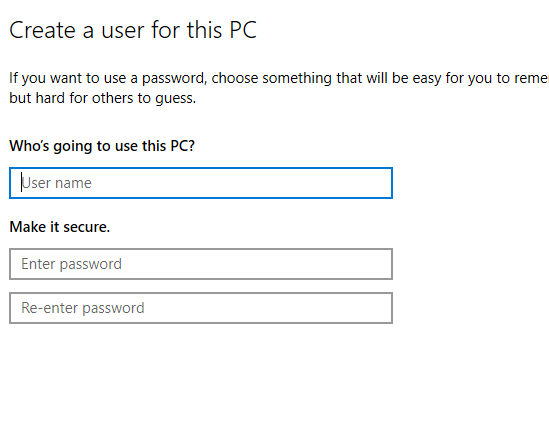
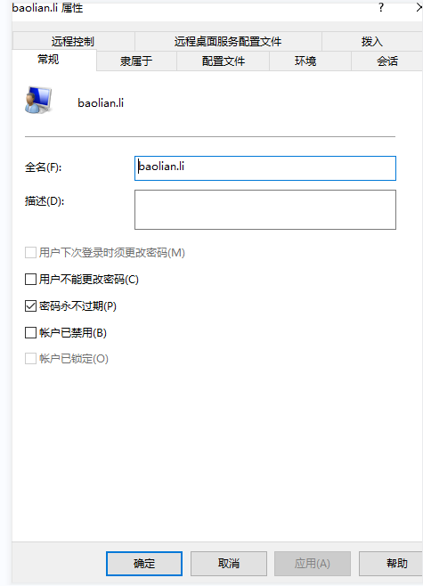

# Windows Accounts & Permissions

> [!summary] Contents
> 1. Create a local user
> 2. Give a domain account admin rights
> 3. Shared folder password expired
> 4. Enable Remote Desktop

> [!tip] Two key tools (`Win + R`)
> - `lusrmgr.msc`: Local Users and Groups (Pro / Enterprise only)
> - `netplwiz`: User Accounts, can add domain accounts

---

## 1. Create a Local User

**Settings → Accounts → Family & other users → Add someone else to this PC**

Then choose: *I don't have this person's sign-in information* → *Add a user without a Microsoft account* → enter name & password.

> [!example]- Screenshots (Win10)
> 1. Settings → Accounts
> 
> 
> 2. Family & other users → Add someone else to this PC
> 
> 3. No sign-in information
> 
> 4. Without Microsoft account
> 
> 5. Enter name & password
> 

---

## 2. Give a Domain Account Admin Rights

1. Run `C:\Windows\System32\Netplwiz.exe`
2. **Add** → enter the domain account (e.g. `DOMAIN\username`)
3. Set the group to **Administrators**

---

## 3. Shared Folder Password Expired

> [!warning] Symptom → cause
> Shared folder suddenly asks for a password / access denied → the **share account's password expired** (Windows expires passwords by default).

1. `Win + R` → `lusrmgr.msc`
2. **Users** → right-click the share account → **Properties**
3. ☐ Uncheck **User must change password at next logon**
4. ☑ Check **Password never expires**

---

## 4. Enable Remote Desktop

1. **This PC → Properties → Remote settings** → enable **Allow remote connections to this computer**
2. `lusrmgr.msc` → set a user and password for remote login
3. Connect with that user via `mstsc`

> [!note] The account must have a password
> Remote Desktop refuses accounts with an empty password.
